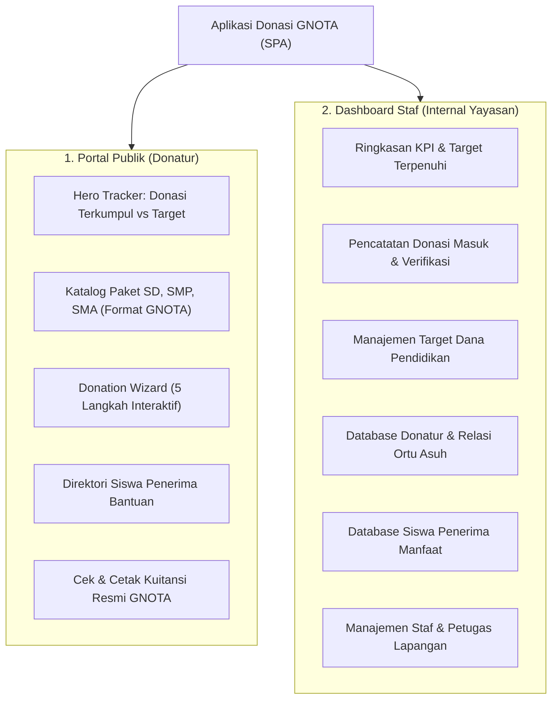

# LAPORAN PROYEK UJIAN TENGAH SEMESTER (UTS) GASAL 2026/2027
## PEMROGRAMAN WEB KELAS A — TEKNIK INFORMATIKA

---

**Mata Kuliah** : Pemrograman Web Kelas A  
**Dosen Pengampu** : Rahmad Syalevi, M.T.I  
**Hari / Tanggal** : Kamis, 12 November 2026  
**Waktu Pelaksanaan**: 09.00 – 11.30 WIB  
**Program Studi** : Teknik Informatika, Universitas Paramadina  
**Sifat Ujian** : Online (Project Based)  

---

### JUDUL PROYEK:
**PENGEMBANGAN ANTARMUKA (FRONT-END) APLIKASI DONASI PENDIDIKAN & MANAJEMEN ORANG TUA ASUH (STUDI KASUS: YAYASAN GERAKAN NASIONAL ORANG TUA ASUH - GNOTA)**

* **Tautan Repositori GitHub** : [https://github.com/j12k14a/gnota-donasi-app](https://github.com/j12k14a/gnota-donasi-app)
* **Tautan Live Demo (Deployment)** : [https://j12k14a.github.io/gnota-donasi-app/](https://j12k14a.github.io/gnota-donasi-app/)

---

## DAFTAR ISI

1. [Desain Interface & Template (Frontend)](#1-desain-interface--template-frontend)
   - 1.1 Analisis Kebutuhan & Konsep Proyek
   - 1.2 Alur UI/UX (User Journey)
   - 1.3 Sistem Desain, Skema Warna & Tipografi
   - 1.4 Komponen & Tampilan Frontend Portal Publik
   - 1.5 Komponen & Tampilan Frontend Dashboard Staf Yayasan
   - 1.6 Desain Responsif & Feedback Pengguna
2. [Pembagian Tugas Kelompok](#2-pembagian-tugas-kelompok)
3. [Tautan Repositori GitHub & Struktur Proyek](#3-tautan-repositori-github)
4. [Tautan Live Demo & Panduan Navigasi](#4-live-demo)
5. [Kesimpulan & Potensi Pengembangan](#5-kesimpulan)

---

## 1. Desain Interface & Template (Frontend)

### 1.1 Analisis Kebutuhan & Konsep Proyek
Aplikasi ini dikembangkan untuk merevitalisasi dan memodernisasi antarmuka web donasi **Yayasan Gerakan Nasional Orang Tua Asuh (GNOTA)** ([http://www.gnota.or.id/beri-donasi/](http://www.gnota.or.id/beri-donasi/)). 

GNOTA memiliki misi utama mencegah anak-anak Indonesia dari keluarga prasejahtera putus sekolah dengan cara menghubungkan mereka dengan **Orang Tua Asuh**. Bantuan yang disalurkan berfokus pada kebutuhan riil perlengkapan sekolah: **seragam lengkap, sepatu, tas ransel, dan perlengkapan alat tulis**.

Untuk menjawab kebutuhan tersebut, antarmuka front-end dibangun dengan arsitektur **Single Page Application (SPA)** berbasis **React 19**, **Vite 5**, dan **Tailwind CSS**, dengan dua mode interaksi utama:
1. **Portal Publik (Donatur & Calon Orang Tua Asuh)**: Menampilkan katalog paket donasi, progress bar capaian nasional, direktori calon anak asuh, wizard pembayaran multi-langkah, dan pelacak kuitansi resmi.
2. **Dashboard Staf Yayasan (Admin & Pengelola Internal)**: Sistem operasional lengkap untuk pencatatan donasi masuk, manajemen target program per jenjang, database donatur & relasi orang tua asuh, database penerima bantuan (anak asuh), serta manajemen staf/karyawan.



---

### 1.2 Alur UI/UX (User Journey)

#### A. Alur Donatur (Public User Flow)
1. **Eksplorasi Program**: Pengguna masuk ke halaman utama ([#/portal](https://j12k14a.github.io/gnota-donasi-app/#/portal)) dan melihat metrik capaian donasi nasional serta paket bantuan pendidikan.
2. **Pemilihan Paket**: Pengguna memilih jenjang (SD / SMP / SMA / Pelosok 3T) dan durasi paket bantuan (1 tahun ajaran, 3 tahun ajaran, atau 6 tahun tuntas).
3. **Alokasi Anak Asuh**: Pengguna dapat memilih opsi *Alokasi Otomatis* (diprioritaskan untuk anak paling membutuhkan) atau *Pilih Anak Tertentu* langsung dari direktori calon anak asuh.
4. **Pengisian Identitas**: Pengguna memasukkan data diri (Individu / Perusahaan CSR) atau memilih opsi donasi anonim (*Hamba Allah*) serta menyertakan doa/pesan penyemangat bagi anak asuh.
5. **Metode Pembayaran**: Pengguna memilih saluran bayar (QRIS Nasional interaktif, Virtual Account BCA/Mandiri/BRI, atau Transfer Bank).
6. **Penerbitan Kuitansi**: Sistem langsung menerbitkan **Kuitansi Resmi Sah GNOTA** ber-nomor registrasi unik dengan stempel digital yang siap dicetak/disimpan sebagai PDF.

#### B. Alur Staf Yayasan (Staff User Flow)
1. **Akses Dashboard**: Mengklik tombol *Dashboard Staf* di navbar atau langsung mengakses tautan deep-link ([#/dashboard](https://j12k14a.github.io/gnota-donasi-app/#/dashboard)).
2. **Monitoring KPI**: Melihat total dana terkumpul, persentase target tahunan, jumlah donatur aktif, dan rasio anak asuh yang telah didampingi vs yang masih mengantre.
3. **Pencatatan Donasi**: Staf dapat memverifikasi donasi yang berstatus *Menunggu Verifikasi*, mengubah status menjadi *Disalurkan*, atau mencatat transaksi manual yang diterima langsung di kantor sekretariat via modal *Catat Donasi Baru*.
4. **Pengelolaan Relasi Donatur & Anak**: Memeriksa siapa donatur yang membiayai anak tertentu, histori donasi mereka, dan memperbarui target dana pendidikan program.

---

### 1.3 Sistem Desain, Skema Warna & Tipografi

Antarmuka dirancang mengikuti identitas visual resmi Yayasan GNOTA dengan sentuhan estetika modern:

* **Skema Warna Utama (Brand Identity)**:
  * **Primary Blue (`#0070cc` / `#0059a4`)**: Melambangkan integritas, amanah, dan perlindungan anak.
  * **Accent Amber / Gold (`#f59e0b` / `#fbbf24`)**: Melambangkan masa depan cerah, harapan, dan kehangatan pendidikan.
  * **Emerald Green (`#10b981`)**: Melambangkan status donasi terverifikasi dan paket tersalurkan.
  * **Slate Neutral (`#0f172a` s/d `#f8fafc`)**: Latar belakang bersih, hierarki teks yang tajam, dan kontras yang ramah mata.
* **Tipografi**:
  * Menggunakan font keluarga **Plus Jakarta Sans** (Google Fonts) dengan variasi bobot `400 (Regular)`, `600 (Semi-bold)`, `700 (Bold)`, dan `800 (Extra-bold)` untuk memastikan keterbacaan optimal di seluruh perangkat.
* **Ikonografi**:
  * Menggunakan **Lucide Icons** secara konsisten di seluruh tombol, badge status, kartu metrik, dan navigasi menu.

---

### 1.4 Komponen & Tampilan Frontend Portal Publik

1. **Top Navbar & Notice Bar**:
   - Memuat logo GNOTA, akreditasi Kemensos RI, menu navigasi anchor, tombol pencarian kuitansi donasi, tombol CTA *"Beri Donasi"*, serta sakelar instan antara Portal Donatur dan Dashboard Staf.
2. **Hero Tracker Section**:
   - Menampilkan total donasi terkumpul secara real-time, target tahunan, serta progress bar visual persentase capaian.
   - Dilengkapi 4 kartu indikator: Jumlah Anak Asuh Terbantu, Total Orang Tua Asuh, Tingkat Penyaluran 100%, dan Wilayah Kabupaten/Kota.
3. **Katalog Paket Donasi (Mengadopsi Web Asli GNOTA)**:
   - **Satu Demi Satu untuk SD**: Paket 1 (Rp 250.000/1 thn), Paket 2 (Rp 750.000/3 thn), Paket 3 (Rp 1.500.000/6 thn penuh). Bantuan berupa baju seragam merah-putih, sepatu, tas, dan alat tulis.
   - **Satu Demi Satu untuk SMP**: Paket 1 (Rp 300.000/1 thn), Paket 2 (Rp 900.000/3 thn). Seragam putih-biru, tas, sepatu, dan modul belajar.
   - **Satu Demi Satu untuk SMA/SMK & Bantuan Daerah 3T (Pelosok)**.
4. **Direktori Calon Anak Asuh (Penerima Donasi)**:
   - Menampilkan kartu profil anak lengkap dengan foto, usia, sekolah, kota/provinsi, kebutuhan spesifik, latar belakang, dan tombol aksi *"Jadikan Anak Asuh Saya"*.
   - Filter interaktif berdasarkan jenjang pendidikan (SD, SMP, SMA) dan kotak pencarian real-time.
5. **Modal Wizard Donasi (5 Langkah)**:
   - Langkah 1: Pilihan Program & Paket.
   - Langkah 2: Alokasi Anak Asuh (Otomatis / Manual).
   - Langkah 3: Identitas Donatur & Pesan Doa.
   - Langkah 4: Metode Bayar (QRIS simulasi dinamis, Virtual Account, Transfer Bank).
   - Langkah 5: Konfirmasi sukses & penerbitan kuitansi instan.
6. **Modal Kuitansi Resmi (Print-Ready)**:
   - Format kuitansi berstandar akuntansi dengan kop surat yayasan, stempel verifikasi digital, QR validasi, rincian donatur dan anak asuh, serta tombol cetak dokumen via browser.

---

### 1.5 Komponen & Tampilan Frontend Dashboard Staf Yayasan

1. **Dashboard Sidebar & Deep Linking**:
   - Navigasi sidebar terstruktur dengan hyperlink asli (`<a href="#/dashboard/...">`) yang mempermudah pembagian tautan langsung ke setiap modul kerja staf.
   - Tombol cepat salin link URL menu saat kursor diarahkan ke menu.
2. **Ringkasan & KPI ([#/dashboard/overview](https://j12k14a.github.io/gnota-donasi-app/#/dashboard/overview))**:
   - 5 kartu metrik utama: Donasi Masuk, Target Tahunan, Donatur Terdaftar, Penerima Bantuan, dan Karyawan Bertugas.
   - Grafik batang visual ketercapaian target per program donasi.
   - Tabel transaksi donasi terkini dengan shortcut kuitansi.
3. **Pencatatan Donasi ([#/dashboard/donations](https://j12k14a.github.io/gnota-donasi-app/#/dashboard/donations))**:
   - Tabel komprehensif pencatatan donasi: No. Kuitansi, Waktu, Donatur, Program, Nominal, Kanal Bayar, Staf Verifikator, Status, dan Tombol Kuitansi.
   - Filter status cepat (`Semua`, `Menunggu`, `Terverifikasi`, `Disalurkan`).
   - Tombol verifikasi langsung dan tombol **Ekspor CSV** untuk pembuatan laporan keuangan.
   - Modal entri donasi manual (donasi tunai kantor atau transfer langsung).
4. **Target Program ([#/dashboard/targets](https://j12k14a.github.io/gnota-donasi-app/#/dashboard/targets))**:
   - Pengelolaan target dana pendidikan per jenjang.
   - Fitur inline edit target yang langsung menghitung sisa kekurangan dana secara reaktif.
5. **Donatur & Orang Tua Asuh ([#/dashboard/donaturs](https://j12k14a.github.io/gnota-donasi-app/#/dashboard/donaturs))**:
   - Manajemen database donatur individu dan kemitraan CSR perusahaan.
   - Menampilkan status Orang Tua Asuh aktif beserta anak-anak asuh yang didampingi.
   - Modal detail profil donatur dan riwayat donasi mereka.
6. **Penerima Donasi / Anak Asuh ([#/dashboard/anak-asuh](https://j12k14a.github.io/gnota-donasi-app/#/dashboard/anak-asuh))**:
   - Database lengkap siswa prasejahtera penerima manfaat.
   - Modal formulir tambah anak asuh baru untuk petugas pendataan lapangan.
7. **Staf & Karyawan ([#/dashboard/karyawan](https://j12k14a.github.io/gnota-donasi-app/#/dashboard/karyawan))**:
   - Manajemen staf yayasan (Divisi Keuangan, Fasilitator Lapangan, CRM Donatur).
   - Formulir input penugasan staf baru dan wilayah kerja.

---

### 1.6 Desain Responsif & Feedback Pengguna

* **Responsive Breakpoints**: Menggunakan sistem grid dan flexbox Tailwind CSS (`sm: 640px`, `md: 768px`, `lg: 1024px`, `xl: 1280px`).
* **Mobile Friendly**: Sidebar dashboard dan tabel transaksi otomatis mendukung scroll horizontal yang mulus pada layar smartphone.
* **Micro-interactions & Feedback**:
  * Efek hover pada kartu donasi dan tombol CTA.
  * Transisi progress bar saat persentase target berubah.
  * Toast notifikasi mengambang saat pengguna menekan tombol *"Salin Link Halaman"*.
  * Sinkronisasi data ke `localStorage` sehingga penambahan data donasi atau anak asuh tidak hilang saat browser di-refresh.

---

## 2. Pembagian Tugas Kelompok

Pengerjaan proyek antarmuka web donasi GNOTA ini dibagi secara terstruktur dengan rincian kontribusi peran sebagai berikut:

| No | Nama Anggota | NIM | Peran Utama | Rincian Kontribusi & Tugas |
|:---|:---|:---|:---|:---|
| 1 | **Muhammad Jawsyan** | *125103034* | **Lead Frontend Architect & Project Manager** | - Perancangan arsitektur aplikasi (React + Vite + Tailwind CSS)<br>- Pengembangan sistem routing hash deep-link (`#/dashboard/...`)<br>- Integrasi state management terpusat (`AppContext`) & persistensi `localStorage`<br>- Setup repositori GitHub, branching, dan konfigurasi CI/CD GitHub Pages deployment |
| 2 | *ALIF SHIDQI PUTRA AMIR* | *25103039* | **UI/UX & Public Portal Developer** | - Perancangan tampilan visual katalog paket donasi (SD, SMP, SMA) sesuai web resmi GNOTA<br>- Pembuatan komponen Hero Tracker & progress bar capaian donasi<br>- Pengembangan antarmuka Direktori Penerima Bantuan (Anak Asuh) & filter jenjang<br>- Perancangan template kuitansi digital resmi siap cetak |
| 3 | *RASYA ZIA NAWFALRY* | *125103027* | **Dashboard & Form Interaction Developer** | - Pengembangan komponen Dashboard Staf (Overview, Pencatatan Donasi, Target Program)<br>- Implementasi Donation Wizard 5 langkah (Pilih Paket $\rightarrow$ Pilih Anak $\rightarrow$ Data Diri $\rightarrow$ QRIS $\rightarrow$ Kuitansi)<br>- Pembuatan formulir entri donasi manual staf dan validasi input data<br>- Fitur ekspor laporan transaksi ke format `.CSV` |
| 4 | *HILMY ABIYYU AMMAR dan RAYA MAHARDIKA IBRAHIM* | *125103050;125103014* | **Database Mockup, QA & Documentation Specialist** | - Penyusunan dataset awal (*mock data*) donatur, program, anak asuh, dan staf yayasan<br>- Pengujian fungsionalitas antarmuka di berbagai ukuran layar (Desktop, Tablet, Mobile)<br>- Pengujian aksesibilitas tautan deep-link dan tombol salin link<br>- Penyusunan laporan teknis proyek UTS dan dokumentasi README |

*(Catatan: Nama dan NIM rekan kelompok dapat disesuaikan dengan data presensi kelompok Anda).*

---

## 3. Tautan Repositori GitHub

Seluruh kode sumber proyek telah dikelola secara terstruktur pada repositori GitHub resmi berikut:

* **URL Repositori** : [https://github.com/j12k14a/gnota-donasi-app](https://github.com/j12k14a/gnota-donasi-app)
* **Branch Utama** : `main`
* **Lisensi** : Open Source / Academic Project
* **Struktur Folder Kode Sumber**:
```text
gnota-donasi-app/
├── .github/
│   └── workflows/
│       └── deploy.yml          # Otomasi CI/CD GitHub Actions (Auto-Deploy)
├── public/                     # Aset statis & favicon
├── src/
│   ├── components/
│   │   ├── common/             # Navbar, Footer, ReceiptModal
│   │   ├── dashboard/          # Sidebar, Overview, DonationMgmt, TargetMgmt, DonaturMgmt, AnakMgmt, KaryawanMgmt
│   │   └── public/             # HeroSection, PaketDonasi, AnakAsuhGallery, DonationModal, CekKuitansi
│   ├── context/
│   │   └── AppContext.jsx      # State management, routing sync, LocalStorage
│   ├── data/
│   │   └── mockData.js         # Dataset simulasi awal (Kampanye, Siswa, Donatur, Staf)
│   ├── App.jsx                 # Layout master & router renderer
│   ├── main.jsx                # Root entry point React
│   └── index.css               # Utilitas Tailwind CSS & scrollbar kustom
├── index.html                  # Dokumen HTML5 utama & Google Fonts
├── tailwind.config.js          # Konfigurasi token warna & tema GNOTA
├── vite.config.js              # Konfigurasi bundler Vite 5
└── package.json                # Dependensi proyek (React 19, Lucide, Tailwind)
```

---

## 4. Live Demo

Aplikasi telah berhasil di-deploy secara publik dan dapat diakses langsung tanpa instalasi tambahan melalui tautan:

* **Tautan Utama (Live Website)**:  
  👉 **[https://j12k14a.github.io/gnota-donasi-app/](https://j12k14a.github.io/gnota-donasi-app/)**

### Tautan Akses Cepat Modul (Deep-Link Navigation):
1. **Portal Publik Donatur**: [https://j12k14a.github.io/gnota-donasi-app/#/portal](https://j12k14a.github.io/gnota-donasi-app/#/portal)
2. **Dashboard Staf - Ringkasan & KPI**: [https://j12k14a.github.io/gnota-donasi-app/#/dashboard/overview](https://j12k14a.github.io/gnota-donasi-app/#/dashboard/overview)
3. **Dashboard Staf - Pencatatan Donasi Masuk**: [https://j12k14a.github.io/gnota-donasi-app/#/dashboard/donations](https://j12k14a.github.io/gnota-donasi-app/#/dashboard/donations)
4. **Dashboard Staf - Target Program Donasi**: [https://j12k14a.github.io/gnota-donasi-app/#/dashboard/targets](https://j12k14a.github.io/gnota-donasi-app/#/dashboard/targets)
5. **Dashboard Staf - Donatur & Orang Tua Asuh**: [https://j12k14a.github.io/gnota-donasi-app/#/dashboard/donaturs](https://j12k14a.github.io/gnota-donasi-app/#/dashboard/donaturs)
6. **Dashboard Staf - Penerima Donasi (Anak Asuh)**: [https://j12k14a.github.io/gnota-donasi-app/#/dashboard/anak-asuh](https://j12k14a.github.io/gnota-donasi-app/#/dashboard/anak-asuh)
7. **Dashboard Staf - Staf & Karyawan**: [https://j12k14a.github.io/gnota-donasi-app/#/dashboard/karyawan](https://j12k14a.github.io/gnota-donasi-app/#/dashboard/karyawan)

---

## 5. Kesimpulan & Potensi Pengembangan

### 5.1 Kesimpulan
1. **Pencapaian Desain**: Antarmuka web donasi GNOTA berhasil dikembangkan dengan tampilan modern, profesional, dan tetap mempertahankan nilai-nilai kemanusiaan serta identitas resmi yayasan.
2. **Kelengkapan Fungsionalitas Frontend**: Seluruh kebutuhan inti proyek telah terakomodasi secara lengkap, meliputi pencatatan donasi multi-status, target capaian dana, database donatur dan relasi orang tua asuh, pendataan penerima manfaat (anak asuh), serta struktur tim pengelola yayasan.
3. **Pengalaman Pengguna (UX) yang Intuitif**: Integrasi wizard donasi interaktif, kuitansi digital siap cetak, serta tautan navigasi langsung (*deep-linking*) memudahkan donatur berdonasi sekaligus mempermudah staf internal mengelola administrasi donasi.
4. **Penerapan Standar Industri**: Proyek memanfaatkan arsitektur modern (React 19 + Tailwind CSS + Vite), sistem kontrol versi Git di GitHub, serta otomasi CI/CD deployment ke GitHub Pages.

### 5.2 Potensi Pengembangan ke Depan (Roadmap)
* **Integrasi Backend REST / GraphQL API**: Menghubungkan front-end dengan backend berbasis Express.js / Laravel dan database relasional (PostgreSQL / MySQL) untuk persistensi data terpusat skala besar.
* **Integrasi Payment Gateway Produksi**: Menghubungkan alur donasi dengan payment gateway resmi Indonesia (seperti Midtrans atau Xendit) untuk mendukung verifikasi pembayaran QRIS dan Virtual Account secara instan via webhook.
* **Integrasi WhatsApp Notification Gateway**: Mengirimkan konfirmasi penerimaan donasi dan bukti kuitansi digital langsung ke nomor WhatsApp donatur menggunakan WhatsApp Cloud API.
* **Fitur Portofolio Perkembangan Anak Asuh**: Menyediakan portal khusus bagi Orang Tua Asuh untuk memantau nilai rapor semester, foto serah terima seragam sekolah, dan surat kabar dari anak asuh yang mereka dampingi.
* **Audit Keuangan & Laporan Akuntabilitas Publik**: Modul download laporan keuangan berkala yang telah diaudit oleh akuntan publik independen demi menjaga asas transparansi dan akuntabilitas yayasan.
